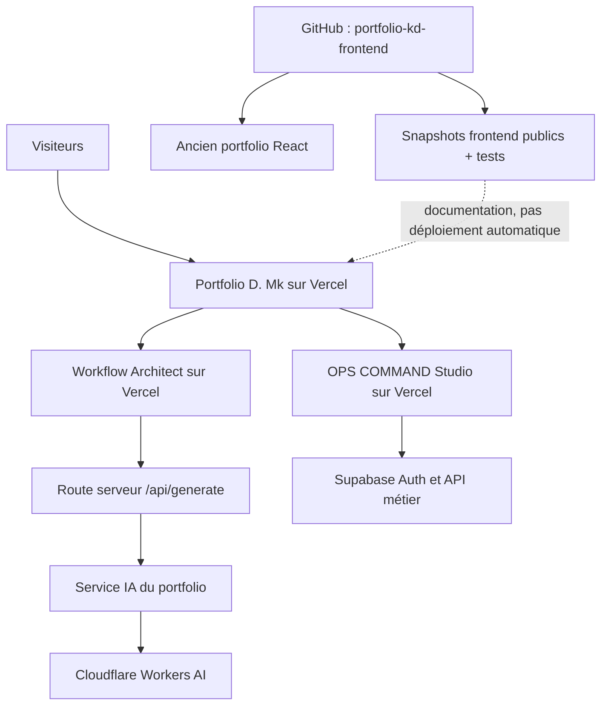

# Architecture — Applications, API et dépôts

**Photo vérifiée le 30 octobre 2026.** Séparer ce qui tourne actuellement de ce qui constitue un historique ou un instantané de code.

## Répartition des responsabilités

| Zone | Ce qui est publiable | Ce qui ne doit pas être mis dans un dépôt public |
| --- | --- | --- |
| Workflow Architect frontend | HTML, scripts, construction des exports, guides | Clé Cloudflare ou secret serveur |
| Workflow Architect API | Contrat d'entrée/sortie et comportement observé | Identifiants, configuration secrète, logs sensibles |
| OPS COMMAND frontend | HTML, JavaScript client, CSS | Jetons de session des utilisateurs |
| OPS COMMAND backend | Description des responsabilités et tests | `service_role`, secrets d'Edge Functions, données personnelles |
| Portfolio actuel | URL, comportement observé, scripts publics des cartes | Variables de production privées |
| Ancien React | Code historique versionné sur GitHub | Secrets ou fichiers locaux non destinés au public |

## Synchronisation

**Attention : GitHub et les projets Vercel actuels ne sont pas liés par une chaîne de livraison automatique.** Les modifications de ce dossier n'entraînent pas la publication du site et une correction Vercel ne modifie pas automatiquement ce dépôt.

Le script `node scripts/verify-showcase.mjs --live` détecte une divergence sur les scripts/CSS publics sélectionnés. Il ne constitue ni un système de déploiement, ni un audit de sécurité backend.

## Principes

- Les appels vers Cloudflare sont faits via des routes serveur.
- Une démo ne doit pas être décrite comme une intégration en production sans validation sur compte test.
- Toute documentation évolue avec le code et porte une date de contrôle.
- Les limitations sont écrites à côté des preuves positives.

[Maintenance](MAINTENANCE.md) · [Sécurité](SECURITE-ET-CONFIDENTIALITE.md)

## Mise à jour de la vitrine — 31 octobre 2026

La couche de présentation des projets est servie par une **réécriture de route Vercel**, appliquée au projet existant \`dmk-portfolio\` :

\`\`\`text
portfolio-d-mk.vercel.app/portfolio/              → déploiement existant dmk-portfolio
portfolio-d-mk.vercel.app/portfolio/project-ops.js → dmk-portfolio-ui-20261031.vercel.app/project-ops.js
portfolio-d-mk.vercel.app/api/*                    → API d'origine, inchangées
\`\`\`

La couche assure l'affichage de trois cartes sélectionnées à l'accueil, la répartition des sept projets, l'uniformisation visuelle et l'intégration de huit documents récents. Son code est publié en instantané dans GitHub, et sa dérive par rapport au script en ligne est contrôlée par GitHub Actions.

**Attention :** une réécriture de route dédiée est une solution de correction ciblée, pas une synchronisation automatisée entre Vercel et GitHub ni une refonte complète du projet source. Réviser ce routage lors d'une future consolidation du code principal.
