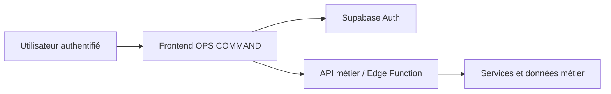

# OPS COMMAND Studio — Étude de projet

**Application :** https://ops-command-studio-kdkongodervilons-projects.vercel.app/  
**Code frontend public :** [index.html](../../showcase/ops-command-studio/index.html) · [app.js](../../showcase/ops-command-studio/app.js) · [style.css](../../showcase/ops-command-studio/style.css)  
**Révision du dossier :** 30 octobre 2026.

## Le problème métier

Les opérations d'entreprise se perdent facilement entre messages, fichiers et validations informelles. OPS COMMAND vise à regrouper **processus, exécutions, responsabilités et historique** dans un espace de pilotage.

## Fonctionnalités identifiables dans le frontend

- Authentification et création de compte via une interface dédiée.
- Choix de l'entreprise / espace de travail.
- Navigation vers **vue d'ensemble, workflows, exécutions, validations, tâches, documents métier, connecteurs, équipe et audit**.
- Interface d'édition et de suivi des opérations, avec actions liées à la session utilisateur.
- Affichage de l'état des connexions et des droits d'interaction.

## Frontières techniques

Le navigateur utilise une clé **Supabase publishable** déjà visible dans le bundle public ; cette clé n'est pas un secret de service et ne suffit pas à elle seule à prouver la sécurité des opérations. L'authentification, les autorisations, les rôles, la séparation entre entreprises et la protection des données doivent être appliqués **côté backend**.

**Important :** ce dépôt contient une copie du frontend public, **pas** le code de l'API métier ni les règles d'autorisation Supabase. L'existence de boutons et d'écrans n'est pas une preuve que toutes les intégrations tierces sont actives.

## Contrôles réalisés

- Page de production **accessible publiquement**, statut HTTP 200, sans demander une connexion Vercel.
- Interface d'authentification visible et chargée.
- Cartes du projet et capture photographique chargées dans le portfolio, testées en vues mobile et ordinateur.

**Non certifié dans cette revue :** création d'entreprise sur un compte test, isolation inter-organisations, validation des politiques RLS, exécution de webhooks métier et continuité des données en production.

## Pour une recette métier complète

1. Créer deux organisations de test séparées, avec des utilisateurs et rôles différents.
2. Vérifier qu'un utilisateur ne peut lire/modifier les données d'une autre organisation.
3. Exécuter une procédure métier fictive de bout en bout.
4. Tester refus de permission, approbation, journal d'audit et doublons.
5. Vérifier les secrets côté serveur, les logs d'erreur et les reprises.

[Consulter le dossier qualité](../QUALITE-ET-TESTS.md) · [Sécurité](../SECURITE-ET-CONFIDENTIALITE.md)
