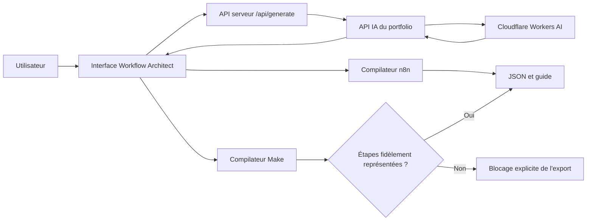

# Workflow Architect — Étude de projet

**Démo :** https://workflow-architect-flax.vercel.app/  
**Source client :** [index.html](../../showcase/workflow-architect/index.html) · [workflow-architect-ai.js](../../showcase/workflow-architect/workflow-architect-ai.js)  
**Dernière validation documentée :** 30 octobre 2026.

## Le problème

Une personne peut savoir quel processus elle souhaite automatiser sans connaître les modules, les conditions d'exécution et le format de fichier attendu par n8n ou Make. Le produit transforme un besoin rédigé librement en **première structure de workflow** accompagnée d'un guide d'installation.

## Parcours utilisateur

1. Décrire l'événement déclencheur et le résultat attendu (texte de 30 caractères minimum).
2. Choisir **n8n** ou **Make**.
3. Envoyer la description à un endpoint serveur du même domaine.
4. Obtenir un plan de modules à partir de **Cloudflare Workers AI**.
5. Compiler le plan en JSON côté frontend, afficher étapes et avertissements.
6. Télécharger le JSON et un guide `.md` ; connecter les outils tiers et effectuer des tests.

## Architecture vérifiée

La clé d'API Cloudflare reste côté serveur. Le **code serveur** du relais et celui du moteur IA ne font pas partie de cet instantané public ; seules les sources déjà accessibles au navigateur sont copiées ici.

## Décisions techniques

- **Compiler de façon déterministe** : l'IA propose des étapes ; le JavaScript impose les structures connues plutôt que d'exécuter du code généré arbitrairement.
- **Exporter n8n inactif** : chaque fichier contient un état `active: false` pour éviter une activation involontaire.
- **Vérifier l'intégrité des connexions n8n** : unicité des noms et correspondance des connexions avec les nœuds du fichier.
- **Éviter le faux fonctionnel Make** : si la demande comporte filtre, approbation, validation, transformation ou planification que le blueprint ne représente pas fidèlement, l'export est refusé et un message explique pourquoi.
- **Informer des paramètres à compléter** : Gmail, Google Sheets, endpoints HTTP, validations et droits d'accès ne sont pas magiquement configurés.

## Recette réalisée

| Test | Résultat | Portée |
| --- | --- | --- |
| API et fournisseur IA | Réponse HTTP 200 ; plan Cloudflare généré | Fonctionnement réel à l'instant du contrôle |
| Génération n8n dans le navigateur | Réussie ; fichiers `.json` et `.md` téléchargés | Structure validée, activation non effectuée |
| Exports n8n | IDs et connexions contrôlés ; workflow inactif | **Pas** d'import certifié sur n8n |
| Make, scénario complexe | Export bloqué, boutons désactivés | Ne présente plus un JSON incomplet comme opérationnel |
| Make, scénario HTTP simple | Blueprint JSON de base structurellement valide | Connexion, import et exécution à tester dans Make |
| Responsive | 1440 px et 390 px sans débordement | Deux résolutions testées, pas tous les appareils |

**Point clé :** un JSON bien formé ne garantit pas qu'un workflow fonctionnera en production. Il faut renseigner les identifiants dans la plateforme cible, vérifier les mappings, tester erreurs et doublons et, si nécessaire, sécuriser une validation humaine.

## Ce qui reste à certifier

- Import réel du JSON sur une instance n8n et dans un compte Make.
- Connexions OAuth / API et permissions effectives.
- Scénarios métier complets, branches conditionnelles et reprise après erreur.
- Tests de charge, isolation et sécurité des intégrations tiers.

[Recette transverse](../QUALITE-ET-TESTS.md) · [Architecture](../ARCHITECTURE.md)
